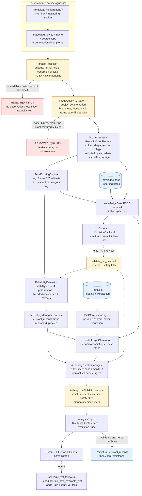
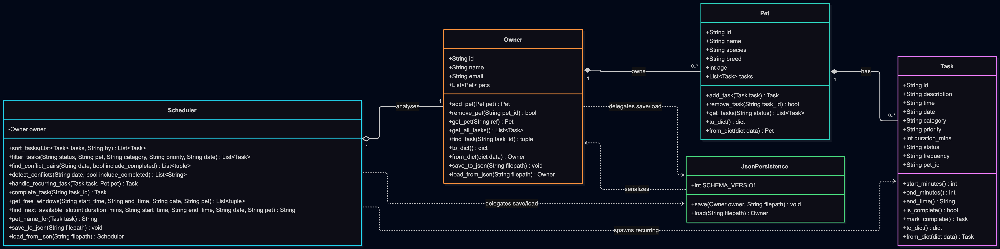

# 🐾 PawPal+ AI — Intelligent Pet Health Monitoring and Management

> **Project 4: Applied AI System.** PawPal+ AI extends my original **PawPal+** pet-care scheduler (Project 2, preserved in full below) with an integrated, photo-based **stool monitoring** feature. It is a **monitoring aid, not a veterinary diagnostic tool.**

## A. Base project and how this extends it

**Original project: PawPal+ (Smart Pet Care Scheduler).** An owner registers pets and care tasks (walks, feeding, medication, vet visits…). PawPal+ sorts by priority/time, filters across pets, detects overlapping tasks, auto-schedules recurring tasks, finds the next free slot and persists everything to JSON. It has a Streamlit app, a CLI demo and a pytest suite. All of that is unchanged and still passes its original 11 tests (the only core change is one backward-compatible field, `Pet.stool_records`).

**What the AI system adds.** The owner picks a pet and submits a stool photo. The system validates the image, estimates consistency (dogs: Purina 1–7 scale), lists visual observations, compares with that pet's history, relates them to the pet's feeding/medication tasks as *possible* context, retrieves cited veterinary reference passages, decides on a veterinary-escalation level, passes everything through safety guardrails, and stores the result in the pet's history. It meaningfully changes the app: results persist in `data.json` with the pet, use existing Feeding/Medication tasks as input, and (opt-in) create a High-priority **Vet** task in the next free slot via the existing `Scheduler`.

### Honest scope statement (read this first)
* The vision component is **classical image processing** (colour segmentation + shape/texture statistics) with hand-set rules. It is **not a trained computer-vision model**, and it has **never been validated on real stool photographs**. I had no real data; all demo/test images are **synthetic illustrations** drawn by `pawpal_ai/samples.py`.
* Evaluation numbers therefore measure internal consistency on synthetic inputs, **not real-world accuracy**.
* An *optional* multimodal-LLM second opinion exists (`--llm`). It was tested only against a **fake client**; it has **not** been run against the live API (no network/API key in my environment).
* Cats get a descriptive category only. No feline numeric scale is applied (see `pawpal_ai/knowledge_base/feline_fecal_scoring.md`).
* The new Streamlit tab was exercised only with a stub (Streamlit could not be installed in the build sandbox). Please run it once yourself.

## B. The AI feature at a glance

Every analysis returns the eight required outputs: **(1)** image-quality assessment, **(2)** classification/score, **(3)** visual observations, **(4)** confidence, **(5)** comparison with history, **(6)** possible associations, **(7)** next steps, **(8)** veterinary escalation, plus retrieved references, disclaimers and an execution trace. If the photo is unusable, the system says so and generates **no** observations.

| Component (file) | Role |
|---|---|
| `imaging.py` `ImageProcessor`, `ImageQualityValidator` | decode/validate bytes (any capture source), focus/light/blank/subject checks, subject segmentation |
| `analysis.py` `StoolAnalyzer`, `HeuristicVisionBackend` | colour/shape/texture features → structured findings (red, dark, pale, yellow, mucus-like, foreign material) |
| `scoring.py` `FecalScoringEngine` | dog Purina 1–7 estimate with alternatives; cat category only |
| `knowledge.py` + `knowledge_base/` | BM25 retrieval over 7 sourced notes; every cited item carries id, title, source, URL |
| `history.py` `PetHistoryManager` | per-pet history on `Pet.stool_records`: trends, repeats, duplicate photos |
| `insights.py` | `DietCorrelationEngine`, `HealthInsightGenerator`, `VeterinaryEscalationEngine` (rule-based, rules listed in output) |
| `guardrails.py` `AIResponseValidator`, `ReliabilityEvaluator` | structure checks, medical-language filter, stability under perturbation, confidence blending |
| `prompts.py`, `llm_backend.py` | structured prompt + few-shot + JSON schema for the optional multimodal second opinion |
| `pipeline.py` `StoolAnalysisPipeline` | the 13-stage workflow with an auditable trace |
| `integration.py`, `ui.py`, `cli.py`, `demo.py` | scheduler integration, Streamlit tab, CLI, reproducible demo |

## C. Architecture diagram

Source: [`architecture.mmd`](architecture.mmd) (rendered copy: `diagrams/architecture.png`). It shows the implemented data flow, including both rejection exits and the optional LLM branch.



## D. Install, run, demo

```bash
python -m venv .venv && source .venv/bin/activate      # Windows: .venv\Scripts\activate
pip install -r requirements.txt
python -m pytest                                        # 78 tests, ~16 s
python evaluate.py                                      # evaluation harness (~20 s)
python -m pawpal_ai.cli demo                            # 7 end-to-end scenarios
python -m pawpal_ai.cli demo --quiet --log ai_interactions.md   # also refresh execution records
python -m pawpal_ai.cli analyze --image sample_images/red_streaks.png --pet Luna --trace
python -m pawpal_ai.cli analyze --image my_photo.jpg --pet Luna --data data.json --schedule-vet
streamlit run app.py                                    # web app: new "🔬 Stool AI" tab
```

CLI options: `--symptoms vomiting,lethargy` (also `not_eating, not_drinking, pale_gums, straining, abdominal_pain`), `--species dog|cat`, `--source smartphone|litter_box|monitoring_station`, `--json`, `--trace`, `--no-save`, `--llm` (optional; needs `ANTHROPIC_API_KEY`, see `.env.example`). Without `--data`, a built-in demo household (Alex, Luna the dog, Mochi the cat) is used and nothing is saved.

### Example inputs and outputs (real captured output)

`python -m pawpal_ai.cli demo --quiet` (images in `sample_images/` are synthetic; Luna's first three records are seeded demo history):

```text
1. Normal-looking stool (dog, with seeded history)           -> completed         escalation=none
2. Loose stool + recent diet change (dog)                    -> completed         escalation=monitor
3. Possible red discoloration, schedule vet visit            -> completed         escalation=contact_vet_soon
4. Cat: descriptive category only, no numeric score          -> completed         escalation=none
5. Repeated loose stool + reported symptoms                  -> completed         escalation=urgent
6. Blurry photo (rejected for quality)                       -> rejected_quality  escalation=inconclusive
7. Invalid file (rejected as input)                          -> rejected_input    escalation=inconclusive
```

**Example 1 — possible red discoloration** (`sample_images/red_streaks.png`, excerpt of the full 8-section report):

```text
2. CLASSIFICATION & SCORING  (heuristic estimate)
   Estimated score: 2  -  Firm but not hard, segmented appearance      Confidence: 0.35
3. VISUAL OBSERVATIONS
   [!] red discoloration (possible, conf 0.71)  Reddish areas are visible. Colour alone cannot show whether this is blood; dyes in food or treats can look similar.
5. COMPARISON   Previous records: 5   Trend: firmer   Score 2 vs typical recent score 3 (change -1).
6. POSSIBLE ASSOCIATIONS (possible only; not diagnoses)
   * [visual_only] Reddish areas can be associated with fresh bleeding from the lower digestive tract, although food dyes can look similar.  [refs: akc-blood-in-stool]
   * [history_context] New feeding entries appeared in the last 7 days ('Dinner (new salmon kibble)'). ... this record alone cannot show that they are related.
8. VETERINARY ESCALATION   Level: CONTACT_VET_SOON - Veterinary consultation recommended within 24-48 hours.   Rules: R1_blood_like_colour
>> Scheduler integration: added Task('Vet consult: stool observation (contact vet soon)', 2026-11-27 08:00, High, 30m, Pending)
```

**Example 2 — blurry photo** (`sample_images/blurry_photo.png`): no fabricated observations.

```text
Status: REJECTED_QUALITY   Usable: NO   Blocking issues: out_of_focus
-> Please retake: hold steady and tap to focus on the sample.
No stool observations were generated because the photo could not be assessed.
8. VETERINARY ESCALATION  Level: INCONCLUSIVE - This photo could not be assessed, so no conclusion is drawn.
```

**Example 3 — invalid file** (`sample_images/invalid_not_an_image.jpg`, plain text with a .jpg name): `Status: REJECTED_INPUT  Rejected before quality checks: File is not a readable image (corrupt or not an image).`

Full reports for all scenarios, plus per-stage execution tables, are in [`ai_interactions.md`](ai_interactions.md) (Part 4, generated).

## E. Reliability and guardrails (demonstrated by tests)

| Mechanism | Where | Demonstrated by |
|---|---|---|
| Image input validation (empty, corrupt, unsupported format, too small, huge) | `ImageProcessor` | `test_processor_*`, evaluate "invalid image" (8 cases) |
| Quality gate (blur, dark, overexposed, blank, no subject, non-stool-coloured subject) | `ImageQualityValidator` | `test_quality_validator_*`, evaluate "unclear photograph" (8) |
| No fabricated observations on rejected photos | validator `structural_issues` | `test_rejected_*` |
| Structured-output validation (ranges, enums, cat ≠ numeric score, rejected ⇒ inconclusive) | `AIResponseValidator` | `test_structural_validation_*` |
| Confidence & uncertainty (capped at 0.9, perturbation stability, caveats, "not detected ≠ absent") | `ReliabilityEvaluator` | `test_stability_*`, `test_not_detected_*` |
| Medical-safety filter (diagnosis claims, unhedged disease names, medication/feeding directives, dosages, causal certainty) | `safety_violations`, `enforce` | evaluate "safety text filter" (14), `test_enforce_redacts_*` |
| Escalation rules (R1–R15, symptom-aware, history-aware) | `VeterinaryEscalationEngine` | `test_escalation_levels`, evaluate "potentially urgent" |
| Optional model output must match a JSON schema and pass the safety filter | `validate_llm_payload` | `test_invalid_or_unsafe_model_output_is_ignored` |

## F. Testing

```bash
python -m pytest            # original 11 + AI tests
python evaluate.py          # prints totals, pass %, guardrail performance, consistency, baseline comparison
python evaluate.py --verbose
```

Latest recorded results are in `model_card.md`. `evaluate.py` exits non-zero if any case fails.

## G. Dependencies

Python 3.10+ (developed on 3.13). Required: `Pillow`, `numpy` (AI), `tabulate`, `wcwidth`, `streamlit` (original app), `pytest`. Optional: `anthropic` (second opinion only). No GPU, no model downloads, no network needed.

## H. Known limitations

* Heuristic features, not a trained model; no real-photo validation; thresholds tuned on the same synthetic generator that produces the tests (circular, see `model_card.md`).
* The "subject present" check is colour/contrast based: it **cannot tell stool from other brown objects** (a chocolate bar on a tile would pass the gate).
* Segmentation assumes the sample contrasts with a fairly plain surface and does not fill the frame; patches that resemble the background and touch the frame edge can be missed; shadows, grass clumps, multiple objects and tilted perspective are not handled.
* Colour is unreliable under coloured light and dim light; diet colourants/supplements look like blood; mucus vs. reflections is ambiguous. Parasites, bacteria and microscopic blood are not detectable from photos.
* Scores 3 vs 4 and 5 vs 6 are borderline even on synthetic data; confidence values are deliberately modest.
* The knowledge base is seven short paraphrased notes (some from consumer sources, flagged in the notes); dog sources are applied to cats only with an explicit label. Escalation rules are conservative project rules, not clinical guidance.
* Diet context uses Feeding/Medication *task descriptions* (the original data model has no food field).
* The multimodal backend and Streamlit tab are not verified against live services.

## Roadmap (not implemented)
Real labelled data and a trained classifier; calibrated confidence; feline scale support after validation; smart-litter-box and camera adapters (the `ImageInput.source_type` hook exists, no device code does); veterinarian-reviewed knowledge base.

## Supporting documents
[`model_card.md`](model_card.md) · [`ai_interactions.md`](ai_interactions.md) · [`ai_collaboration_reflection.md`](ai_collaboration_reflection.md) (template for you to personalise) · [`architecture.mmd`](architecture.mmd)

---

# Original project documentation (PawPal+, Project 2)


PawPal+ is an object-oriented pet care manager written in Python. An owner registers pets, adds care tasks (walks, feeding, medication, grooming…), and PawPal+ keeps the day organised: it **sorts** by priority and time, **filters** across pets, **warns about overlapping tasks**, **auto-schedules recurring tasks**, **finds the next free time slot**, and **saves everything to JSON**. It ships with a Streamlit web app, a colourful CLI demo, and a pytest suite.

---

## 📐 System Architecture

The design is four domain classes plus a small persistence handler. The diagram below is rendered from [`diagrams/uml_final.mmd`](diagrams/uml_final.mmd) (Mermaid source).



*(Simplified here for readability — attributes and methods for every class are in `diagrams/uml_final.mmd`.)*

| Class | Responsibility |
|---|---|
| `Task` | One care activity: description, date/time, duration, category, priority, frequency, status. Validates its own input. |
| `Pet` | Owns a list of `Task`s; add/remove/list them. Stamps each task with its `pet_id`. |
| `Owner` | Owns a list of `Pet`s; exposes `get_all_tasks()` so algorithms work across every pet. |
| `Scheduler` | "The brain" — all algorithms. Stateless apart from the `Owner` it analyses, so it is trivial to rebuild on every Streamlit rerun. |
| `JsonPersistence` | Versioned, atomic JSON save/load of the whole object graph. |

**Why composition?** Deleting a pet deletes its tasks, and deleting an owner deletes their pets (`*--`). The `Scheduler` only *observes* an owner (`o--`), so it holds a reference and owns nothing.

---

## ✨ Core Features & Smarter Scheduling Algorithms

### 1. Sorting — `Scheduler.sort_tasks()`
Multi-tier sort across **all pets**: priority (High → Medium → Low), then date, then time. `by="time"` gives a chronological day-planner view instead. Python's sort is stable and the key is a tuple, so it runs in O(n log n) with deterministic tie-breaking.

### 2. Filtering — `Scheduler.filter_tasks()`
Combine any of `status`, `pet` (id **or** name), `category`, `priority` and `date`; criteria are AND-ed and case-insensitive. Composes with sorting: `sort_tasks(filter_tasks(pet="Luna"))`.

### 3. Conflict Detection & Time-Blocking — `Scheduler.detect_conflicts()`
Each task occupies a half-open window `[time, time + duration)`. Tasks on the same date are sorted by start and swept with an early exit, so only genuinely overlapping pairs are examined. Back-to-back tasks (08:00–08:30 then 08:30–09:00) are **not** conflicts. Because one owner performs every task, overlaps are flagged **across pets** too, and the warning says how many minutes overlap and whether the clash is the same pet or different pets. Completed tasks are ignored by default.

### 4. Automated Recurrence — `Scheduler.handle_recurring_task()` / `complete_task()`
Completing a **Daily** or **Weekly** task spawns the next occurrence using `datetime.timedelta(days=1 | weeks=1)`, so month ends, year ends and leap days are handled by the standard library rather than hand-rolled maths. It is **idempotent** (completing twice never double-spawns) and de-duplicates if the next occurrence already exists.

### 5. ⭐ Next Available Slot Finder — `Scheduler.find_next_available_slot()`
Given a duration and a search window, PawPal+ merges busy intervals for the day and walks the gaps, returning the earliest `HH:MM` that fits (or `None`). `get_free_windows()` exposes every gap, and a `pet=` argument restricts the search to one pet's schedule instead of the whole household. An exact fit counts (a 30-minute gap fits a 30-minute task).

---

## 🎨 Professional UI & CLI Output Formatting

- **CLI (`main.py`)** — tables rendered with [`tabulate`](https://pypi.org/project/tabulate/) (`rounded_outline`), **ANSI colours** for priorities (red/yellow/green) and statuses, and **emoji** section headers. Colours switch on automatically in a real terminal and off when output is piped or `NO_COLOR` is set (set `FORCE_COLOR=1` to force them). Emoji are kept out of table cells on purpose: without the optional `wcwidth` package, `tabulate` mis-measures double-width characters and borders drift. `wcwidth` is in `requirements.txt`.
- **Streamlit (`app.py`)** — tabs, metrics, emoji category icons, 🔴🟡🟢 priority badges, ✅/⏳ status badges, `st.warning` banners for each conflict, `st.dataframe` tables, and an expander with the same `tabulate` text report.

---

## 💾 Data Persistence Workflow

```python
owner.save_to_json("data.json")             # or scheduler.save_to_json(...)
owner = Owner.load_from_json("data.json")   # or Scheduler.load_from_json(...)
```

- The file is a versioned document: `{"version": 1, "owner": {…pets…tasks…}}`.
- Saves are **atomic** (write to a temp file, then `os.replace`), so a crash can't leave a half-written `data.json`.
- Loading a missing file raises `FileNotFoundError`; malformed or incomplete JSON raises a clear `ValueError`.
- The Streamlit app auto-loads `data.json` on first run and has **Save**, **Load** and **Download JSON** buttons in the sidebar.
- `data.json` is git-ignored so personal data isn't committed.

---

## 🚀 Quickstart

```bash
python -m venv .venv
source .venv/bin/activate        # Windows: .venv\Scripts\activate
pip install -r requirements.txt

python main.py                   # CLI demo (colour in a terminal)
streamlit run app.py             # web app
python -m pytest                 # run the test suite
```

### Project layout

```
pawpal_system.py        Task, Pet, Owner, Scheduler, JsonPersistence
app.py                  Streamlit UI
main.py                 CLI demonstration
tests/test_pawpal.py    original pytest suite (11 tests)
tests/test_ai_stool.py  AI package tests (67 tests)
pawpal_ai/              AI stool-monitoring package (see section B)
evaluate.py             evaluation harness
architecture.mmd        Mermaid architecture of the AI pipeline
sample_images/          synthetic demo images
diagrams/uml_final.mmd  Mermaid class diagram
reflection.md           design reflection
ai_interactions.md      AI workflow + model comparison
```

---

## 🖥️ Sample CLI Output (`python main.py`)

Captured with colours off (piped output):

```text
🐾  PawPal+ — Smart Pet Care Scheduler  (CLI demo)
Owner: Alex <alex@example.com>   |   Demo date: 2026-10-13
Pets : Luna the Dog (Labrador, 4y), Mochi the Cat (Siamese, 2y)

📋  1. Tasks as entered (unsorted)
──────────────────────────────────────────────────────────────────────────
╭────────────┬─────────────┬───────┬────────────────────┬────────────┬────────────┬───────┬──────────┬───────────╮
│ Date       │ Window      │ Pet   │ Task               │ Category   │ Priority   │ Dur   │ Repeat   │ Status    │
├────────────┼─────────────┼───────┼────────────────────┼────────────┼────────────┼───────┼──────────┼───────────┤
│ 2026-10-13 │ 18:10-18:40 │ Luna  │ Evening training   │ Enrichment │ ● Medium   │ 30m   │ Once     │ ○ Pending │
│ 2026-10-13 │ 07:30-08:00 │ Luna  │ Morning walk       │ Exercise   │ ● High     │ 30m   │ Daily    │ ○ Pending │
│ 2026-10-13 │ 12:00-12:05 │ Luna  │ Heartworm pill     │ Medication │ ● High     │ 5m    │ Once     │ ○ Pending │
│ 2026-10-13 │ 17:30-17:45 │ Luna  │ Dinner             │ Feeding    │ ● High     │ 15m   │ Daily    │ ○ Pending │
│ 2026-10-13 │ 18:00-18:20 │ Mochi │ Grooming brush-out │ Grooming   │ ● Low      │ 20m   │ Weekly   │ ○ Pending │
│ 2026-10-13 │ 07:45-08:00 │ Mochi │ Breakfast          │ Feeding    │ ● High     │ 15m   │ Daily    │ ○ Pending │
│ 2026-10-13 │ 09:00-09:20 │ Mochi │ Laser-pointer play │ Enrichment │ ● Medium   │ 20m   │ Once     │ ○ Pending │
╰────────────┴─────────────┴───────┴────────────────────┴────────────┴────────────┴───────┴──────────┴───────────╯

🔝  2. Sorted by Priority (High → Low), then Date/Time
──────────────────────────────────────────────────────────────────────────
╭────────────┬─────────────┬───────┬────────────────────┬────────────┬────────────┬───────┬──────────┬───────────╮
│ Date       │ Window      │ Pet   │ Task               │ Category   │ Priority   │ Dur   │ Repeat   │ Status    │
├────────────┼─────────────┼───────┼────────────────────┼────────────┼────────────┼───────┼──────────┼───────────┤
│ 2026-10-13 │ 07:30-08:00 │ Luna  │ Morning walk       │ Exercise   │ ● High     │ 30m   │ Daily    │ ○ Pending │
│ 2026-10-13 │ 07:45-08:00 │ Mochi │ Breakfast          │ Feeding    │ ● High     │ 15m   │ Daily    │ ○ Pending │
│ 2026-10-13 │ 12:00-12:05 │ Luna  │ Heartworm pill     │ Medication │ ● High     │ 5m    │ Once     │ ○ Pending │
│ 2026-10-13 │ 17:30-17:45 │ Luna  │ Dinner             │ Feeding    │ ● High     │ 15m   │ Daily    │ ○ Pending │
│ 2026-10-13 │ 09:00-09:20 │ Mochi │ Laser-pointer play │ Enrichment │ ● Medium   │ 20m   │ Once     │ ○ Pending │
│ 2026-10-13 │ 18:10-18:40 │ Luna  │ Evening training   │ Enrichment │ ● Medium   │ 30m   │ Once     │ ○ Pending │
│ 2026-10-13 │ 18:00-18:20 │ Mochi │ Grooming brush-out │ Grooming   │ ● Low      │ 20m   │ Weekly   │ ○ Pending │
╰────────────┴─────────────┴───────┴────────────────────┴────────────┴────────────┴───────┴──────────┴───────────╯

🕒  2b. Sorted chronologically (day planner view)
──────────────────────────────────────────────────────────────────────────
╭────────────┬─────────────┬───────┬────────────────────┬────────────┬────────────┬───────┬──────────┬───────────╮
│ Date       │ Window      │ Pet   │ Task               │ Category   │ Priority   │ Dur   │ Repeat   │ Status    │
├────────────┼─────────────┼───────┼────────────────────┼────────────┼────────────┼───────┼──────────┼───────────┤
│ 2026-10-13 │ 07:30-08:00 │ Luna  │ Morning walk       │ Exercise   │ ● High     │ 30m   │ Daily    │ ○ Pending │
│ 2026-10-13 │ 07:45-08:00 │ Mochi │ Breakfast          │ Feeding    │ ● High     │ 15m   │ Daily    │ ○ Pending │
│ 2026-10-13 │ 09:00-09:20 │ Mochi │ Laser-pointer play │ Enrichment │ ● Medium   │ 20m   │ Once     │ ○ Pending │
│ 2026-10-13 │ 12:00-12:05 │ Luna  │ Heartworm pill     │ Medication │ ● High     │ 5m    │ Once     │ ○ Pending │
│ 2026-10-13 │ 17:30-17:45 │ Luna  │ Dinner             │ Feeding    │ ● High     │ 15m   │ Daily    │ ○ Pending │
│ 2026-10-13 │ 18:00-18:20 │ Mochi │ Grooming brush-out │ Grooming   │ ● Low      │ 20m   │ Weekly   │ ○ Pending │
│ 2026-10-13 │ 18:10-18:40 │ Luna  │ Evening training   │ Enrichment │ ● Medium   │ 30m   │ Once     │ ○ Pending │
╰────────────┴─────────────┴───────┴────────────────────┴────────────┴────────────┴───────┴──────────┴───────────╯

🔎  3. Filtering
──────────────────────────────────────────────────────────────────────────
Luna's tasks:
╭────────────┬─────────────┬───────┬──────────────────┬────────────┬────────────┬───────┬──────────┬───────────╮
│ Date       │ Window      │ Pet   │ Task             │ Category   │ Priority   │ Dur   │ Repeat   │ Status    │
├────────────┼─────────────┼───────┼──────────────────┼────────────┼────────────┼───────┼──────────┼───────────┤
│ 2026-10-13 │ 07:30-08:00 │ Luna  │ Morning walk     │ Exercise   │ ● High     │ 30m   │ Daily    │ ○ Pending │
│ 2026-10-13 │ 12:00-12:05 │ Luna  │ Heartworm pill   │ Medication │ ● High     │ 5m    │ Once     │ ○ Pending │
│ 2026-10-13 │ 17:30-17:45 │ Luna  │ Dinner           │ Feeding    │ ● High     │ 15m   │ Daily    │ ○ Pending │
│ 2026-10-13 │ 18:10-18:40 │ Luna  │ Evening training │ Enrichment │ ● Medium   │ 30m   │ Once     │ ○ Pending │
╰────────────┴─────────────┴───────┴──────────────────┴────────────┴────────────┴───────┴──────────┴───────────╯

High-priority feeding tasks:
╭────────────┬─────────────┬───────┬───────────┬────────────┬────────────┬───────┬──────────┬───────────╮
│ Date       │ Window      │ Pet   │ Task      │ Category   │ Priority   │ Dur   │ Repeat   │ Status    │
├────────────┼─────────────┼───────┼───────────┼────────────┼────────────┼───────┼──────────┼───────────┤
│ 2026-10-13 │ 17:30-17:45 │ Luna  │ Dinner    │ Feeding    │ ● High     │ 15m   │ Daily    │ ○ Pending │
│ 2026-10-13 │ 07:45-08:00 │ Mochi │ Breakfast │ Feeding    │ ● High     │ 15m   │ Daily    │ ○ Pending │
╰────────────┴─────────────┴───────┴───────────┴────────────┴────────────┴───────┴──────────┴───────────╯

🚨  4. Conflict detection (time + duration windows, across all pets)
──────────────────────────────────────────────────────────────────────────
⚠️  Conflict on 2026-10-13: 'Morning walk' (Luna, 07:30-08:00) overlaps 'Breakfast' (Mochi, 07:45-08:00) by 15 min [different pets, one owner].
⚠️  Conflict on 2026-10-13: 'Grooming brush-out' (Mochi, 18:00-18:20) overlaps 'Evening training' (Luna, 18:10-18:40) by 10 min [different pets, one owner].

2 conflict(s) found.

🔁  5. Automated recurrence
──────────────────────────────────────────────────────────────────────────
✔ Completed 'Morning walk' (Daily) → new task auto-created for 2026-10-14 07:30
✔ Completed 'Grooming brush-out' (Weekly) → new task auto-created for 2026-10-20 18:00
✔ Completed 'Heartworm pill' (Once) → one-off, nothing to schedule.

Calling complete_task('t3') again is a safe no-op: spawned=None

╭────────────┬─────────────┬───────┬────────────────────┬────────────┬────────────┬───────┬──────────┬──────────╮
│ Date       │ Window      │ Pet   │ Task               │ Category   │ Priority   │ Dur   │ Repeat   │ Status   │
├────────────┼─────────────┼───────┼────────────────────┼────────────┼────────────┼───────┼──────────┼──────────┤
│ 2026-10-13 │ 07:30-08:00 │ Luna  │ Morning walk       │ Exercise   │ ● High     │ 30m   │ Daily    │ ✔ Done   │
│ 2026-10-13 │ 12:00-12:05 │ Luna  │ Heartworm pill     │ Medication │ ● High     │ 5m    │ Once     │ ✔ Done   │
│ 2026-10-13 │ 18:00-18:20 │ Mochi │ Grooming brush-out │ Grooming   │ ● Low      │ 20m   │ Weekly   │ ✔ Done   │
╰────────────┴─────────────┴───────┴────────────────────┴────────────┴────────────┴───────┴──────────┴──────────╯

Upcoming (pending) after completions:
╭────────────┬─────────────┬───────┬────────────────────┬────────────┬────────────┬───────┬──────────┬───────────╮
│ Date       │ Window      │ Pet   │ Task               │ Category   │ Priority   │ Dur   │ Repeat   │ Status    │
├────────────┼─────────────┼───────┼────────────────────┼────────────┼────────────┼───────┼──────────┼───────────┤
│ 2026-10-13 │ 07:45-08:00 │ Mochi │ Breakfast          │ Feeding    │ ● High     │ 15m   │ Daily    │ ○ Pending │
│ 2026-10-13 │ 09:00-09:20 │ Mochi │ Laser-pointer play │ Enrichment │ ● Medium   │ 20m   │ Once     │ ○ Pending │
│ 2026-10-13 │ 17:30-17:45 │ Luna  │ Dinner             │ Feeding    │ ● High     │ 15m   │ Daily    │ ○ Pending │
│ 2026-10-13 │ 18:10-18:40 │ Luna  │ Evening training   │ Enrichment │ ● Medium   │ 30m   │ Once     │ ○ Pending │
│ 2026-10-14 │ 07:30-08:00 │ Luna  │ Morning walk       │ Exercise   │ ● High     │ 30m   │ Daily    │ ○ Pending │
│ 2026-10-20 │ 18:00-18:20 │ Mochi │ Grooming brush-out │ Grooming   │ ● Low      │ 20m   │ Weekly   │ ○ Pending │
╰────────────┴─────────────┴───────┴────────────────────┴────────────┴────────────┴───────┴──────────┴───────────╯

✨ Walk was completed, so its 07:30 conflict with breakfast is now cleared:
✅ No conflicts remain on 2026-10-13.

🧭  6. Next available slot finder (search window 08:00-20:00)
──────────────────────────────────────────────────────────────────────────
╭─────────┬──────────────────╮
│ Need    │ Earliest start   │
├─────────┼──────────────────┤
│ 20 min  │ 08:00            │
│ 45 min  │ 08:00            │
│ 90 min  │ 09:20            │
│ 500 min │ none free        │
╰─────────┴──────────────────╯

Free windows on 2026-10-13:
╭────────┬───────┬──────────╮
│ From   │ To    │ Length   │
├────────┼───────┼──────────┤
│ 08:00  │ 09:00 │ 60 min   │
│ 09:20  │ 17:30 │ 490 min  │
│ 17:45  │ 18:10 │ 25 min   │
│ 18:40  │ 20:00 │ 80 min   │
╰────────┴───────┴──────────╯

💾  7. JSON persistence round-trip
──────────────────────────────────────────────────────────────────────────
Saved  → data_demo.json (3714 bytes)
Loaded ← data_demo.json: 2 pets, 9 tasks
✅ Round-trip verified: reloaded data is identical to the original.
(Temporary data_demo.json removed.)
```

---

## ✅ Test Results (`python -m pytest`)

The suite has **11 tests**: the 7 required ones (task completion & recurrence, pet task management, priority/time sorting, filtering, conflict overlap, next-slot finder, JSON round-trip) plus edge cases for month/year/leap-day recurrence, duplicate prevention, input validation, and midnight clamping.
< collected 11 items                                                                            

tests/test_pawpal.py::test_task_completion_and_recurrence PASSED                        [  9%]
tests/test_pawpal.py::test_pet_task_management PASSED                                   [ 18%]
tests/test_pawpal.py::test_scheduler_sorting_priority_and_time PASSED                   [ 27%]
tests/test_pawpal.py::test_scheduler_filtering PASSED                                   [ 36%]
tests/test_pawpal.py::test_conflict_detection_overlap PASSED                            [ 45%]
tests/test_pawpal.py::test_next_available_slot_finder PASSED                            [ 54%]
tests/test_pawpal.py::test_json_persistence_roundtrip PASSED                            [ 63%]
tests/test_pawpal.py::test_recurrence_crosses_month_and_year_boundaries PASSED          [ 72%]
tests/test_pawpal.py::test_recurrence_does_not_create_duplicates PASSED                 [ 81%]
tests/test_pawpal.py::test_task_validation PASSED                                       [ 90%]
tests/test_pawpal.py::test_task_running_past_midnight_is_clamped PASSED                 [100%]

===================================== 11 passed in 0.07s =======================>
```

---

## ⭐ System Confidence Rating: 5 / 5

**Scheduler core: ★★★★★.** All five algorithms and the persistence layer are covered by tests that assert exact outputs, including boundaries (back-to-back tasks, exact-fit slots, leap days, double completion, corrupt files). To check the tests themselves have teeth, seven deliberate bugs (e.g. weekly recurrence = +1 day, ignoring priority when sorting, off-by-one in overlap or slot fitting) were injected one at a time; each was caught by the test that should catch it.

**Known limitations:** tasks are single-date (no multi-day tasks; a window running past midnight is clamped at 24:00), the scheduler flags and *suggests* but never auto-reschedules conflicts, and times are naive local times (no time zones / DST).
